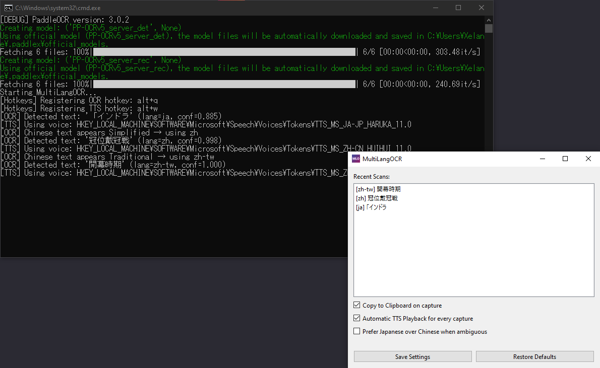

# MultiLangOCR

Press a hotkey, drag a box around any text on your screen, and get it as text: copied to the clipboard and, if you like, read aloud. Works on **Windows** and **macOS**, offline, for **English, Japanese and Chinese** (Simplified and Traditional, including vertical Japanese).

<p align="center">
  
  <br>
  
</p>

## Features

- Global hotkey, then drag over any part of any screen (multiple monitors and Retina / scaled displays work)
- Recognises English, Japanese, Simplified and Traditional Chinese, and vertical Japanese; short words as well as paragraphs
- Copies the result to the clipboard automatically
- Reads it aloud in a voice matching the detected language
- Everything runs on your computer. The OCR models are bundled, so there is no account, no upload and no network use
- Lives in the menu bar (macOS) or system tray (Windows)

## Download

Get the latest build from the [Releases page](../../releases/latest).

| | File | Needs |
|---|---|---|
| Windows | `MultiLangOCR-windows-x64.zip` | Windows 10 or 11 |
| macOS | `MultiLangOCR-macos-arm64.zip` | macOS 14 or newer, Apple Silicon |

Unzip it anywhere and run it. There is nothing to install and no Python is needed. Intel Macs are not covered by the releases; you can try running from source (untested). Linux is not supported yet.

The builds are **not code-signed**, so each system shows a warning the first time.

### Windows first launch

Windows SmartScreen may say "Windows protected your PC". Click **More info**, then **Run anyway**.

### macOS first launch

1. Drag `MultiLangOCR.app` to your **Applications** folder.
2. Open it. macOS will refuse ("cannot be opened because the developer cannot be verified" or similar).
3. Open **System Settings > Privacy & Security**, scroll down to the message about MultiLangOCR, click **Open Anyway** and confirm with your password. (Terminal alternative: `xattr -dr com.apple.quarantine /Applications/MultiLangOCR.app`.)
4. Open the app again and **grant the permissions below**.

#### macOS permissions

MultiLangOCR needs three permissions. It tells you which are missing and offers buttons that open the right Settings page; switch **MultiLangOCR** on in each:

| Permission (System Settings > Privacy & Security) | Why |
|---|---|
| **Screen & System Audio Recording** | To see what is on screen. Without it macOS hands back only your wallpaper, so scans find nothing. **Quit and reopen the app after enabling it.** |
| **Accessibility** | To receive the global hotkeys |
| **Input Monitoring** | To receive the global hotkeys |

Hotkeys start working on their own a few seconds after you grant their permissions. Until then, use **Scan now** in the menu bar icon.

Because the app is unsigned, macOS may forget these permissions after you replace the app with a newer version. If scans or hotkeys stop working after an update, remove MultiLangOCR from those three lists (the minus button), open the app again and re-enable it.

## Using it

| | Windows | macOS |
|---|---|---|
| Scan a region | **Alt+Q** | **Ctrl+Option+Q** |
| Read the last scan aloud | **Alt+W** | **Ctrl+Option+W** |

(Option+Q types a character on a Mac, so the Mac default uses Ctrl+Option.) You can also pick **Scan now** from the tray / menu bar icon.

1. Press the scan hotkey. The screen freezes as a still image.
2. Drag a box around the text. **Esc** or a right-click cancels.
3. The text is copied and shown briefly on screen. Press the read-aloud hotkey to hear it.

Click the tray / menu bar icon (or choose **Open MultiLangOCR**) to see recent scans. Clicking one reads it aloud again and copies it.

### Preferences

Open them from the tray / menu bar icon:

- **Copy to Clipboard on capture**
- **Automatic TTS Playback for every capture**
- **Prefer Japanese over Chinese when ambiguous**: text made only of kanji, such as 設定, is valid Japanese and valid Chinese. With this on it is treated as Japanese (it only affects which voice reads it).
- **Speak a welcome message when the app starts**: it also warms up the speech engine so your first real speech is quick.

### Changing the hotkeys

Quit the app, then edit `settings.json`:

| | |
|---|---|
| Windows | `%APPDATA%\MultiLangOCR\settings.json` |
| macOS | `~/Library/Application Support/MultiLangOCR/settings.json` |

```json
{
    "ocr_hotkey": "ctrl+shift+f9",
    "tts_hotkey": "f8"
}
```

Modifiers: `ctrl`, `alt` (Option on a Mac), `shift`, `cmd` (the Windows key on Windows). The last part is a letter, a digit or `f1` to `f20`. A letter or digit needs at least one modifier; a lone F-key is fine. An invalid value falls back to the default, and the reason is printed in the log.

## Languages and voices

Reading the text works for English, Japanese and Chinese. Korean is **not** supported (the bundled model cannot read Hangul).

Text-to-speech uses the voices installed on your computer. If a language is silent or sounds wrong, install a voice for it:

- **macOS**: System Settings > Accessibility > Spoken Content > System Voice > Manage Voices
- **Windows**: Settings > Time & language > Language & region, add the language and make sure its **Text-to-speech** feature is installed

## Run from source

Python 3.12 is what it is tested with (3.11 should work; very new Python versions may not have `onnxruntime` wheels yet).

```bash
python3 -m venv .venv
source .venv/bin/activate        # Windows: .venv\Scripts\activate
pip install -r requirements.txt
python main.py                   # Windows: launch.bat also works
```

When you run from source, the operating-system permissions (macOS) apply to the program you started it from: Terminal, iTerm or VS Code.

## Build the app yourself

```bash
pip install -r requirements.txt -r requirements-build.txt
pyinstaller packaging/MultiLangOCR.spec
```

The result is `dist/MultiLangOCR/` on Windows and `dist/MultiLangOCR.app` on macOS (a one-folder build; a one-file build would unpack about 300 MB on every launch). To check a build works without opening any window or asking for any permission:

```bash
dist/MultiLangOCR.app/Contents/MacOS/MultiLangOCR --self-test       # macOS
dist\MultiLangOCR\MultiLangOCR.exe --self-test report.txt            # Windows: result goes to report.txt
```

### Publishing a release

1. Set the new number in `version.py`, commit and push.
2. Tag it and push the tag: `git tag v2.0.0 && git push origin v2.0.0` (the tag must equal `v` plus the number in `version.py`).
3. The [Release workflow](.github/workflows/release.yml) builds both apps, runs `--self-test` on each, and attaches the zips to a new GitHub release.

Use **Actions > Release > Run workflow** to build and test both without publishing anything. The icons are generated by `tools/make_icons.py` and committed, so a release build never needs to run it.

## Troubleshooting

| Problem | What to do |
|---|---|
| Hotkey does nothing (macOS) | Grant **Accessibility** and **Input Monitoring** (see above). Check that your keys aren't taken by another app. |
| Scan finds nothing, or the frozen image is only your wallpaper (macOS) | Grant **Screen & System Audio Recording**, then quit and reopen the app. |
| A scan of a few words returns nothing | Select a little more around the text. Tell us the text if it keeps failing. |
| No sound, or the wrong voice | Install a voice for that language (see above). |
| Need to see what was captured | Start with `MULTILANGOCR_DEBUG=1`. The screenshot and the cropped selection are saved in a `debug` folder inside the settings folder. |

## Privacy

Nothing leaves your computer. Screenshots are processed in memory and are only written to disk in debug mode. Settings are kept in the `settings.json` file described above. When run from source the app prints the exact path at startup.

## Third-party software

MultiLangOCR uses [RapidOCR](https://github.com/RapidAI/RapidOCR) with the PP-OCR models from [PaddleOCR](https://github.com/PaddlePaddle/PaddleOCR) (both Apache-2.0), [ONNX Runtime](https://github.com/microsoft/onnxruntime), [OpenCC](https://github.com/BYVoid/OpenCC) for Simplified/Traditional detection, [pynput](https://github.com/moses-palmer/pynput) for hotkeys, and [PyQt6](https://www.riverbankcomputing.com/software/pyqt/) for the interface. PyQt6 is available under the GPL v3 or a commercial licence, which applies to the packaged builds that include it.

## Licence

[MIT](LICENSE) for the MultiLangOCR source code.
